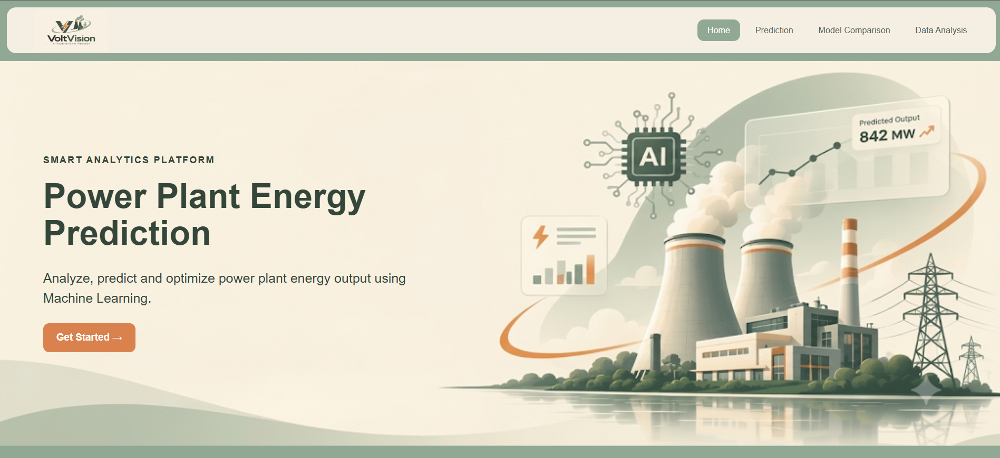

# VoltVision — Power Plant Energy Prediction

VoltVision is a React and FastAPI application for predicting net electrical output from power-plant ambient conditions. It provides single-model predictions, predictions from all available models, dataset summary endpoints, and a model-evaluation view.

## Visual preview

An overview of VoltVision's homepage, featuring its intelligent energy prediction platform.



## Features

- Predict power output with six scikit-learn regressors or a PyTorch ANN.
- Compare the seven model predictions for the same input.
- View model metrics calculated on the backend's fixed holdout split.
- Retrieve dataset statistics, distributions, correlations, and sample rows through the API.
- Use the React interface on desktop or mobile.

## Technology

| Area | Technologies |
| --- | --- |
| Frontend | React, Vite, Axios, Recharts |
| Backend | FastAPI, Pydantic, Uvicorn |
| Machine learning | scikit-learn, PyTorch, joblib |
| Data | pandas, NumPy, CSV |

## Quick start

Run the backend and frontend in separate terminals. See the [setup guide](docs/SETUP_GUIDE.md) for Windows and Unix activation commands.

```powershell
# Terminal 1
cd backend
python -m venv .venv
.\.venv\Scripts\Activate.ps1
python -m pip install -r requirements.txt
uvicorn main:app --reload
```

```powershell
# Terminal 2
cd Frontend
npm ci
npm run dev
```

Open the Vite URL printed by the development server (normally `http://localhost:5173`). The frontend currently calls the API at `http://127.0.0.1:8000`.

## Documentation

- [Project overview](docs/PROJECT_OVERVIEW.md)
- [Machine-learning implementation](docs/MACHINE_LEARNING.md)
- [Dataset](docs/DATASET.md)
- [API reference](docs/API_DOCUMENTATION.md)
- [Setup guide](docs/SETUP_GUIDE.md)
- [Model evaluation](docs/MODEL_EVALUATION.md)

The starter-template [Frontend README](Frontend/README.md) is unchanged.
