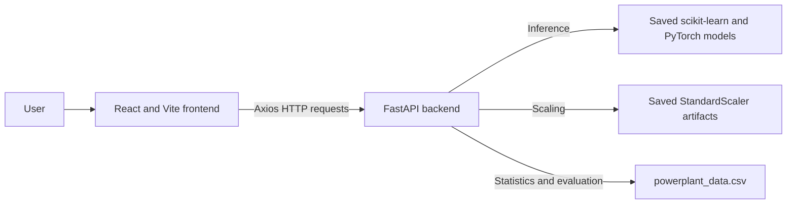

# Project Overview

[← README](../README.md) · [Machine Learning](MACHINE_LEARNING.md) · [Dataset](DATASET.md) · [API](API_DOCUMENTATION.md)

## Problem

The application estimates a combined-cycle power plant's net electrical energy output (`PE`) from ambient temperature, exhaust vacuum, ambient pressure, and relative humidity. The backend loads persisted regression models and exposes predictions through a FastAPI API.

## Objectives

- Accept four numeric conditions and return a prediction in megawatts.
- Let users select a model or compare all seven model outputs for the same input.
- Expose dataset summaries and model evaluation metrics through API routes.
- Provide a browser interface built with React.

## Architecture



The frontend and API run as separate local development servers. The browser sends requests to `http://127.0.0.1:8000`; the API's CORS configuration allows `http://localhost:5173`.

## System workflow

1. The user enters AT, V, AP, and RH in the prediction or comparison form.
2. The React page sends the values to `/predict` or `/predict/all`.
3. FastAPI validates the input, applies the scaler required by the selected model, and calls the loaded model artifact.
4. The API returns a prediction in MW. The comparison page displays all model outputs in a table and chart.
5. The evaluation page requests `/evaluation`. Dataset summaries are separately available from `/analysis`.

## Project structure

```text
.
├── README.md
├── docs/
├── backend/
│   ├── main.py
│   ├── powerplant_data.csv
│   ├── requirements.txt
│   ├── models/       # Six joblib models and ANN weights
│   └── scalers/      # Two joblib StandardScaler artifacts
└── Frontend/
    ├── index.html
    ├── package.json
    ├── public/       # Hero artwork and favicon
    └── src/
        ├── App.jsx
        ├── components/Navbar.jsx
        └── pages/    # Home, prediction, comparison, evaluation
```

There are no notebooks or model-training scripts in the checked-in project. The model files are loaded at API startup. See [Machine Learning](MACHINE_LEARNING.md) for what can and cannot be verified about training.

## Related documentation

- [Dataset details](DATASET.md)
- [API endpoints and schemas](API_DOCUMENTATION.md)
- [Local setup](SETUP_GUIDE.md)
- [Measured model performance](MODEL_EVALUATION.md)
